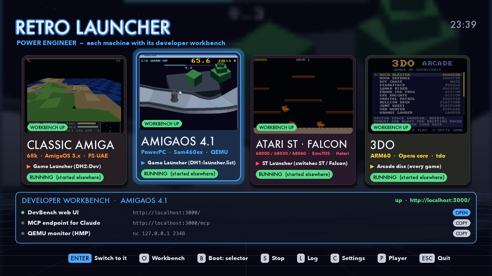
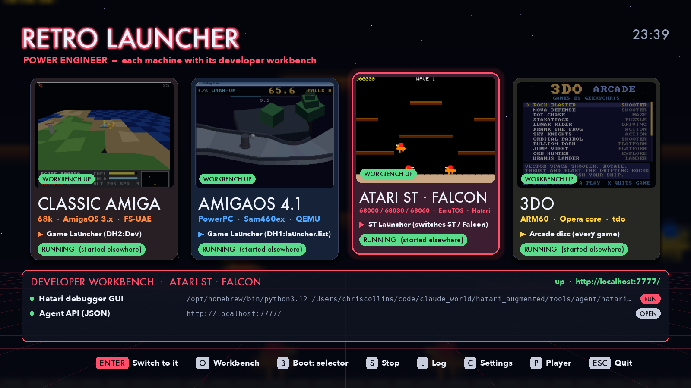

<p align="center"></p>

# Retro Launcher

A full-screen front end that boots four retro machines, each straight into
its own game selector:

| Machine | Emulator | Boots into (default) | Plain boot |
|---|---|---|---|
| Classic Amiga (68k, AmigaOS 3.x) | FS-UAE (AmiKit) | `DH2:Dev/launcher`, the GadTools game launcher | Workbench |
| AmigaOS 4.1 (PowerPC) | QEMU `sam460ex` | `DH1:launcher`, the same launcher built for OS4 | Workbench |
| Atari ST / STE / Falcon | Hatari | `C:\LAUNCHER.PRG`, the ST launcher | the GEM desktop |
| 3DO | Opera core, via `tdo` | the Arcade disc (every game) | one game disc |

It runs on macOS, Linux and Windows (Python 3.9+ and pygame-ce), and can be
driven with a keyboard, a mouse or a gamepad.


## What it does

* **One screen for every machine.** Each machine has a card that shows
  screenshots from its games, what it will boot into, and whether its
  emulator is running.
* **Boots into the game selector by default.** Press B on a card to switch
  that machine to a plain desktop boot instead. Shift+Enter does the other
  boot mode once.
* **Knows what's already running.** The launcher spots an emulator even if
  you started it yourself. Pressing Enter on a running machine brings its
  window to the front instead of starting a second copy.
* **Stays out of the way.** While you play, the menu waits in the background,
  or hides if you prefer. It comes back to the front when the emulator quits.
* **Everything can be changed.** The settings screen (C) covers paths,
  commands, the steps run before each boot, fullscreen and labels. All of it
  is saved to one TOML file that you can also edit by hand.
* **Logs every launch.** L shows the output of the last launch. The settings
  screen can preview the exact commands a launch will run.
* **Power Engineer mode.** P adds each machine's developer workbench to the
  menu: the AmigaDevBench web UIs and MCP endpoints, the FS-UAE debugger,
  the QEMU monitor, Hatari's debugger GUI and agent, and the 3DO DevBench.
  O (or a click) opens one, starting it first if it's down.

## Quick start

```sh
git clone https://github.com/geekychris/retro-launcher.git
cd retro-launcher
./run.sh                    # macOS / Linux: makes .venv and installs pygame-ce on the first run
run.bat                     # Windows
```

Then press **C** and point the paths at your emulators. Each path shows ✓ when
it exists and ✗ when it doesn't. The defaults assume the sister projects
below are checked out side by side in `~/code/claude_world`. Change
**General → Projects folder** (or set `RETRO_PROJECTS`) if yours are
somewhere else.

```sh
./run.sh --windowed         # in a window this time
./run.sh --launch 3do       # boot a machine as soon as the menu opens
./run.sh --print amigaos4   # print the commands a launch would run (add --plain for the other mode)
./build-app.sh              # a stand-alone app: dist/Retro Launcher.app (macOS) or dist/retro-launcher/
```

## Controls

| Key | Mouse | Gamepad | Does |
|---|---|---|---|
| ← → (A/D, Tab), 1–6 | wheel, click a card | d-pad / left stick | choose a machine |
| Enter / Space | click the selected card | A | launch it, or switch to it when it's running |
| Shift+Enter | | | launch it in the other boot mode, this time only |
| B | click the boot line | X | toggle game selector ↔ plain boot (saved) |
| S, then S again | | B | stop the emulator (also one started elsewhere) |
| L | | Y | the last launch's log |
| C | | Start | settings |
| F | | | launcher fullscreen on/off |
| P | | | Power Engineer mode on/off |
| O | click a workbench row | | open the machine's workbench (starting it if it's down) |
| Esc / Q | | | quit (emulators keep running) |

## Documentation

| Guide | What's in it |
|---|---|
| [User guide](docs/user-guide.md) | The menu, statuses, boot modes, switching to a running machine, the settings screen |
| [Configuration](docs/configuration.md) | `config.toml`: every setting, command templates, adding your own machine |
| [The machines](docs/machines.md) | What each machine boots, how the selector boot is chosen, one-time setup, fullscreen |
| [How it works](docs/how-it-works.md) | Modules, the launch lifecycle, process detection, window switching on each OS |
| [Building and packaging](docs/building.md) | Running from source, stand-alone apps, the icon and doc screenshots |
| [Troubleshooting](docs/troubleshooting.md) | MISSING and FAILED cards, windows that don't come forward, per-OS notes |

## Screenshots

| | |
|---|---|
|  |  |
| Each card cross-fades through screenshots of that machine's games | The footer follows the selection; a running machine's Enter switches to it |
|  |  |
| B switches a machine to a plain boot | Settings: every path shows what it expands to, with ✓ or ✗ |
|  |  |
| Power Engineer mode (P): every machine's workbench state, and the selected one's tools | Click a row to open, copy or run it; O opens the first |
|  |  |
| The game selector inside AmigaOS 4.1 | The game selector inside the Atari ST |

## Sister projects

The machines, their game selectors and the games come from these
repositories:

* [amiga_mcp](https://github.com/geekychris/amiga_mcp): the Amiga
  cross-development setup and the OS4 QEMU start script. Its
  [amiga_games](https://github.com/geekychris/amiga_games) submodule has the
  Amiga game launcher for 68k and OS4.
* [atari_st_games](https://github.com/geekychris/atari_st_games): the Atari
  games, the ST launcher and `make_drive.py`, which builds and boots its
  drive.
* [hatari](https://github.com/geekychris/hatari) (checked out as
  `hatari_augmented`): Hatari with an agent API.
* [3do-dev](https://github.com/geekychris/3do-dev) (checked out as
  `3do_dev`): the 3DO toolchain, the `tdo` runner and the Arcade disc.

None of them is needed to run the launcher itself. Any emulator can be put
behind a card; see [Configuration](docs/configuration.md#adding-a-machine).

## License

MIT. See [LICENSE](LICENSE).
