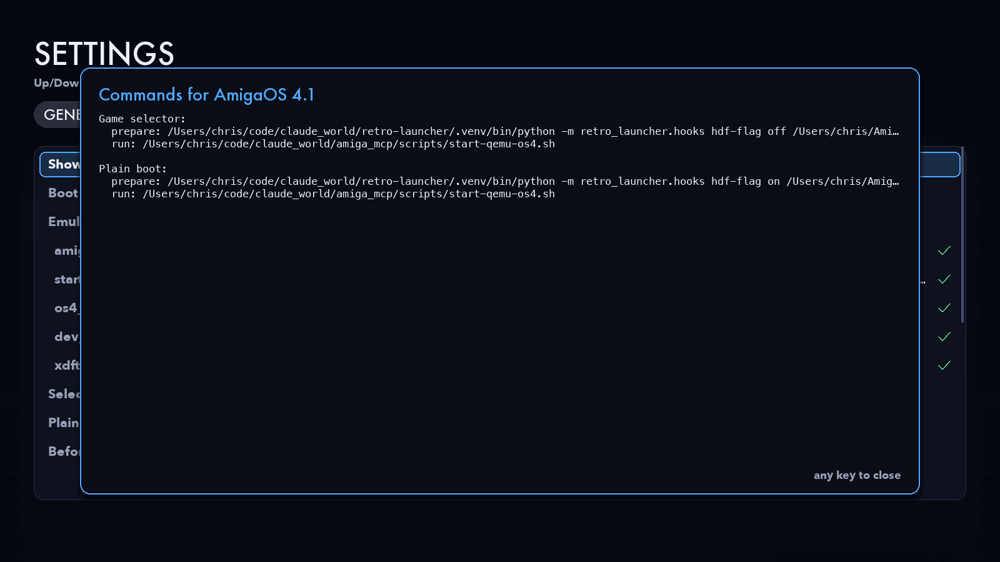

# Configuration

Everything the launcher does is driven by one TOML file. You can edit it on
the settings screen (C) or in a text editor.

* [Where the file is](#where-the-file-is)
* [How the file and the defaults combine](#how-the-file-and-the-defaults-combine)
* [`[general]`](#general)
* [`[platforms.KEY]`](#platformskey)
* [Command templates](#command-templates)
* [Prepare steps and the hooks helper](#prepare-steps-and-the-hooks-helper)
* [Environment variables](#environment-variables)
* [Detecting a running emulator](#detecting-a-running-emulator)
* [Adding a machine](#adding-a-machine)
* [Checking a configuration](#checking-a-configuration)

## Where the file is

| OS | Path |
|---|---|
| macOS | `~/Library/Application Support/RetroLauncher/config.toml` |
| Linux | `$XDG_CONFIG_HOME/retro-launcher/config.toml` (usually `~/.config/retro-launcher/config.toml`) |
| Windows | `%APPDATA%\RetroLauncher\config.toml` |

`--config FILE` uses another file. The first run writes the file with every
default filled in and commented. **General → Open config file in editor**
opens it.

## How the file and the defaults combine

The launcher starts from built-in defaults (`retro_launcher/config.py`,
`defaults()`) and lays the file over them:

* Tables merge key by key, so a file that sets only
  `[platforms.atari.paths] machine = "falcon"` keeps every other default.
* Values, including lists such as `prepare_selector`, replace the default
  whole.
* A table under `[platforms]` with a new name adds a machine (see
  [Adding a machine](#adding-a-machine)).

Saving from the settings screen rewrites the whole file, with the standard
comments, so comments you added by hand don't survive it. **Reset everything
to defaults** (General) and **Reset this machine to defaults** (a machine's
tab) put the defaults back.

A file that doesn't parse doesn't stop the launcher. It starts with the
defaults, and the settings screen shows the error.

## `[general]`

```toml
[general]
fullscreen = true
boot_to_selector = true
while_playing = "background"
stop_others_on_launch = false
autostart = ""
projects = "~/code/claude_world"
engineer_mode = false
```

| Key | Default | |
|---|---|---|
| `fullscreen` | `true` | The menu fills the screen. F toggles it; `--windowed` overrides it for one run |
| `boot_to_selector` | `true` | Machines whose `boot_to_selector` is `"default"` boot into their game selector |
| `while_playing` | `"background"` | `"background"`: the menu stays open behind the emulator. `"hide"`: it disappears. Either way it returns when the emulator quits |
| `stop_others_on_launch` | `false` | Starting a machine stops the emulators this launcher started |
| `autostart` | `""` | A machine key to launch as soon as the menu opens |
| `projects` | `~/code/claude_world` | `{projects}` in paths: the folder holding the sister projects. The `RETRO_PROJECTS` environment variable changes the default |
| `engineer_mode` | `false` | Power Engineer mode: the menu also shows each machine's developer workbench. P toggles it |

## `[platforms.KEY]`

The built-in keys are `amiga68k`, `amigaos4`, `atari` and `3do`, and the cards
appear in that order. Machines you add come after them.

```toml
[platforms.amigaos4]
enabled = true
title = "AmigaOS 4.1"
subtitle = "PowerPC  ·  Sam460ex  ·  QEMU"
accent = "#4fa8ff"
selector_label = "Game Launcher (DH1:launcher.list)"
plain_label = "Workbench desktop"
emulator_fullscreen = false
boot_to_selector = "default"
cwd = ""
selector_command = "{start_script}"
plain_command = "{start_script}"
prepare_selector = ["{helper} hdf-flag off {dev_hdf} launcher.skip --xdftool {xdftool}"]
prepare_plain = ["{helper} hdf-flag on {dev_hdf} launcher.skip --xdftool {xdftool}"]
process_match = "qemu-system-ppc"

[platforms.amigaos4.paths]
amiga_mcp = "{projects}/amiga_mcp"
start_script = "{amiga_mcp}/scripts/start-qemu-os4.sh"
os4_dir = "~/AmigaOS4"
dev_hdf = "{os4_dir}/amigaos4-dev.hdf"
xdftool = "xdftool"

[platforms.amigaos4.env]
OS4_DIR = "{os4_dir}"

[platforms.amigaos4.env_fullscreen]
DISPLAY_ARG = "cocoa,full-screen=on,zoom-to-fit=on,show-cursor=on"
```

| Key | |
|---|---|
| `enabled` | Show the card on the menu |
| `title`, `subtitle` | The card's heading and the line under it |
| `accent` | The card's colour, `#rrggbb` |
| `selector_label`, `plain_label` | The boot line for each mode. `{game}` in `plain_label` shows the file name of the `game` path |
| `artwork` | *(optional)* a folder of `.png` / `.jpg` screenshots for the card. Default: the built-in `assets/KEY/` |
| `boot_to_selector` | `"default"` (follow `[general]`), `"on"` or `"off"`. B on the menu sets it |
| `emulator_fullscreen` | Keep the `?fullscreen:` words and apply `env_fullscreen` |
| `paths` | Named values used in the commands as `{name}`; the settings screen checks each one |
| `selector_command`, `plain_command` | The emulator command for each boot mode |
| `prepare_selector`, `prepare_plain` | Commands run, in order, before the emulator. If one fails, the launch stops |
| `cwd` | The working folder for every command (may use `{name}`) |
| `env`, `env_fullscreen` | Environment variables for every command; the second set only with `emulator_fullscreen` |
| `process_match` | Text in a process's command line that means this emulator is running |

## Command templates

Each command is a single string. The launcher:

1. **splits it into words** the way a shell would (POSIX rules; on Windows,
   quotes are kept), so `"a path with spaces"` is one word;
2. **drops conditional words.** `?fullscreen:WORD` stays, as `WORD`, only
   when `emulator_fullscreen` is on, and `?windowed:WORD` only when it is off;
3. **expands each word.** `{name}` becomes the value of that variable;
   values can use other variables, up to eight levels deep. A leading `~`
   becomes your home folder;
4. replaces a word that is exactly `{helper}` with the hooks helper's
   command (see below).

Because expansion happens after splitting, a path with spaces in `[paths]`
stays one argument. There is no need to quote it.

The variables are the machine's `[paths]` entries plus these:

| Variable | Value |
|---|---|
| `{home}` | your home folder |
| `{projects}` | `[general] projects` |
| `{python}` | the Python running the launcher. In a stand-alone build, the first `python3` / `python` on `PATH` |
| `{config_dir}` | the folder holding `config.toml` |
| `{helper}` | the hooks helper (whole words only) |

No shell is involved, so pipes, `&&` and redirection don't work. To chain
commands, use prepare steps or a script.

## Prepare steps and the hooks helper

`prepare_selector` and `prepare_plain` are lists of commands run one after
the other, with the same template rules, before the emulator starts. Their
output goes to the machine's log. If one exits with a non-zero code, the
launch stops and the card shows FAILED.

The launcher includes a small helper for the two Amiga boot switches. In a
template, `{helper}` expands to `python -m retro_launcher.hooks`, or
`<app> --hooks` in a stand-alone build:

```text
{helper} flag on|off PATH
    on: create PATH (a host file, e.g. in FS-UAE's shared folder)
    off: delete it

{helper} hdf-flag on|off HDF NAME [--xdftool X]
    on: write the file NAME into the root of the Amiga hard file HDF
    off: delete it (via amitools' xdftool; only while nothing has HDF open)
```

You can run it yourself too:

```sh
.venv/bin/python -m retro_launcher.hooks hdf-flag on ~/AmigaOS4/amigaos4-dev.hdf launcher.skip
```

## Environment variables

Every command runs with the launcher's own environment plus:

* `PYTHONPATH`, with the launcher's folder added, so the helper can be
  imported from any working folder;
* the machine's `env` table;
* the machine's `env_fullscreen` table, when `emulator_fullscreen` is on.

Values are expanded like paths. The AmigaOS 4 machine uses this to hand
`OS4_DIR` and, in fullscreen, `DISPLAY_ARG` to `start-qemu-os4.sh`.

## Detecting a running emulator

`process_match` is expanded, then compared with every process's command line
(`ps -axo pid,command` on macOS and Linux, `Win32_Process` on Windows). A
process counts when:

* the whole match text appears in its command line, **and**
* the match's first word appears in the program name or its first argument.

The second rule stops a shell or editor whose command line just mentions the
emulator from counting. Examples:

| Machine | `process_match` | Matches |
|---|---|---|
| Classic Amiga | `{fsuae}` | the FS-UAE binary |
| AmigaOS 4 | `qemu-system-ppc` | any PowerPC QEMU |
| Atari | `{hatari}` | the Hatari binary |
| 3DO | `{tdo} --bios` | `tdo --bios … run …` (not other `tdo` commands) |

Leave it empty to turn detection off for a machine.

## `[platforms.KEY.workbench]`

What Power Engineer mode shows for a machine: its developer tools.

```toml
[platforms.3do.workbench]
url = "http://localhost:3330/"
start = "{tdo} devbench --port 3330"
links = [
    "3DO DevBench web UI|open|http://localhost:3330/",
    "MCP server for Claude (stdio)|copy|{tdo} mcp",
]
```

| Key | |
|---|---|
| `url` | Checked every two seconds; any HTTP reply means the workbench is up (the card's **WORKBENCH UP**) |
| `start` | The command that brings the workbench up, run in the machine's `cwd` through your login shell (so it gets your PATH even when the launcher was started from the Finder). Empty: launching the machine brings it up |
| `links` | One row each, `"Label|kind|target"`. `open`: open the target in the browser. `copy`: copy it to the clipboard. `run`: run it as a command (its words are expanded like a launch command). The first link is what **O** does |

A row whose workbench is down starts it first (`start`, or the machine
itself) and acts once `url` answers, giving up after four minutes. The
output of `start` and `run` commands goes to `logs/<machine>-workbench.log`.

The Atari's debugger GUI runs with `{gui_python}` (default `{python}`): set
it in `[platforms.atari.paths]` to a Python with Tk, such as Homebrew's
`python3.12` once `python-tk@3.12` is installed.

## Adding a machine

Add a table under `[platforms]` with a new key. Anything you leave out has
no default, so set at least the title, the commands and the match:

```toml
[platforms.c64]
enabled = true
title = "Commodore 64"
subtitle = "6510  ·  VICE"
accent = "#8f7cff"
selector_label = "Game menu disk"
plain_label = "BASIC prompt"
artwork = "~/Pictures/c64-shots"
boot_to_selector = "default"
emulator_fullscreen = false
selector_command = "{vice} -autostart {menu_disk} ?fullscreen:-fullscreen"
plain_command = "{vice} ?fullscreen:-fullscreen"
prepare_selector = []
prepare_plain = []
cwd = ""
process_match = "x64sc"

[platforms.c64.paths]
vice = "/opt/homebrew/bin/x64sc"
menu_disk = "~/c64/menu.d64"

[platforms.c64.env]

[platforms.c64.env_fullscreen]
```

The menu shares its width between the cards, and the number keys 1–6 select
the first six. Without `artwork`, a card shows a plain panel in its accent
colour.

## Checking a configuration

* **On the menu:** a card says MISSING and names any paths that don't exist.
* **In the settings:** each path shows its expansion and ✓ / ✗. **Preview
  commands** shows the exact prepare steps, command and working folder for
  both boot modes.

  
* **From a terminal:**

  ```console
  $ ./run.sh --print atari
  run: /…/python /…/atari_st_games/st_launcher/make_drive.py --no-build --run --machine ste
  config: /Users/you/Library/Application Support/RetroLauncher/config.toml

  $ ./run.sh --print amigaos4 --plain
  prepare: /…/python -m retro_launcher.hooks hdf-flag on /Users/you/AmigaOS4/amigaos4-dev.hdf launcher.skip --xdftool xdftool
  run: /…/amiga_mcp/scripts/start-qemu-os4.sh
  config: …
  ```
