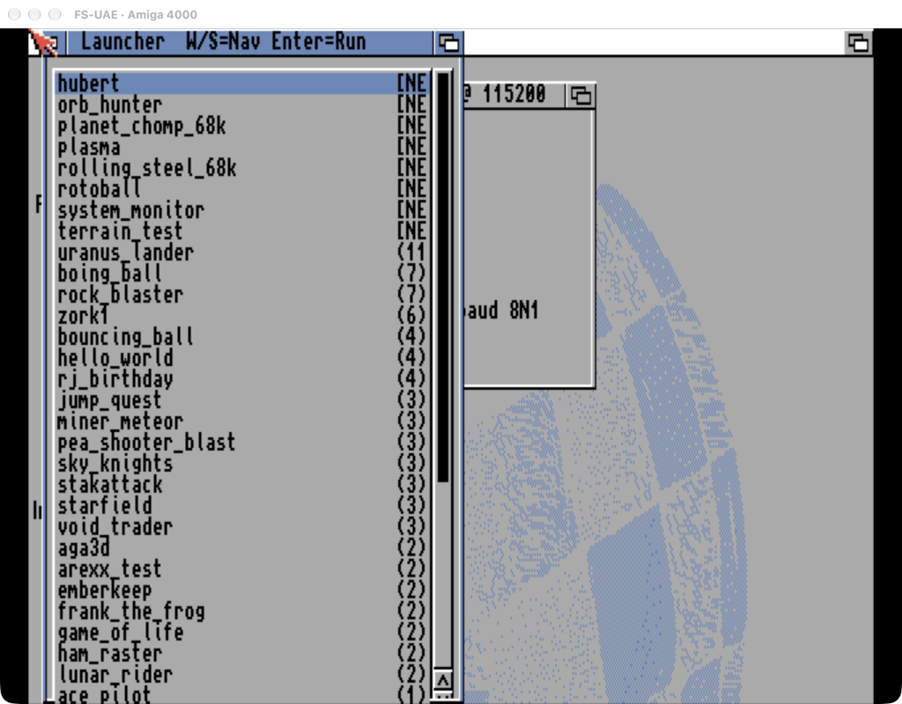
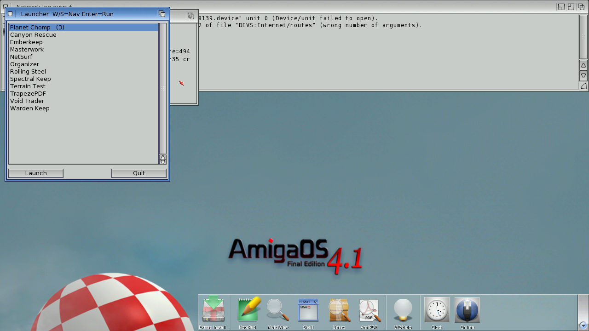
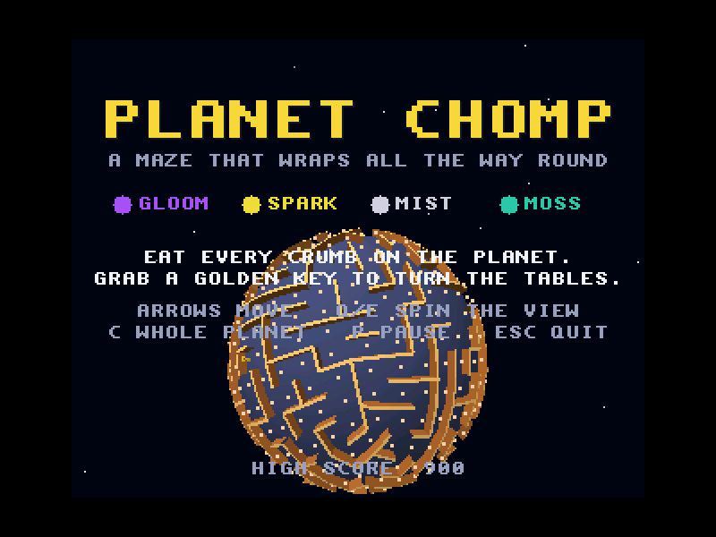
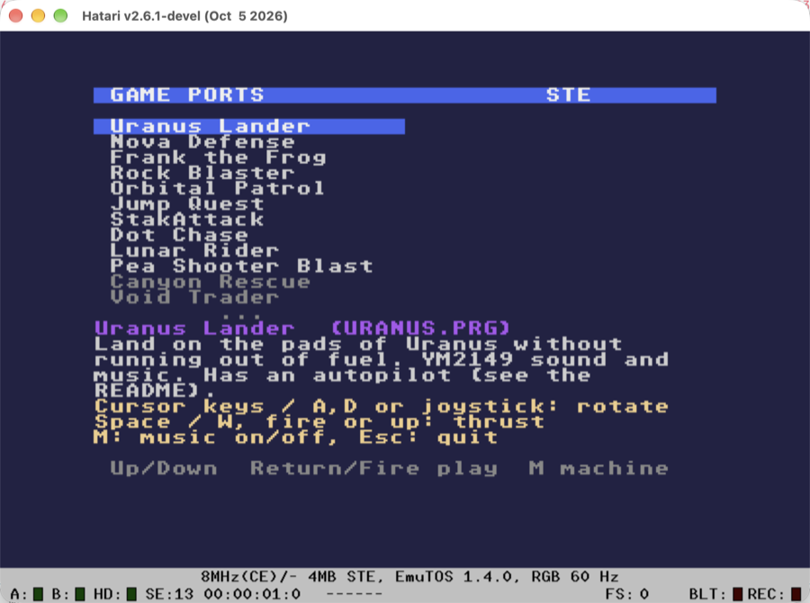
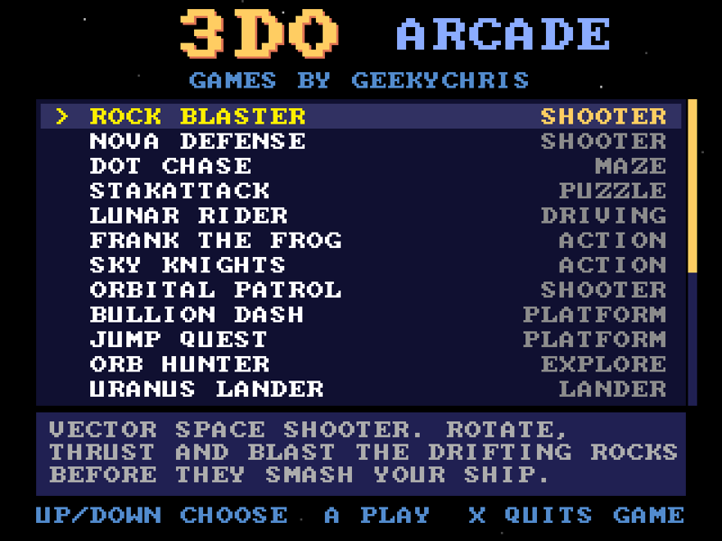

# The machines

What each machine runs, how the launcher picks between its game selector and
a plain boot, and what has to be in place for it to work.

* [Classic Amiga (68k)](#classic-amiga-68k)
* [AmigaOS 4.1 (PowerPC)](#amigaos-41-powerpc)
* [Atari ST / STE / Falcon](#atari-st--ste--falcon)
* [3DO](#3do)
* [Fullscreen per emulator](#fullscreen-per-emulator)

The two Amigas use the same switch. Their startup script starts the game
launcher unless a file called `launcher.skip` is on the drive the script
checks. The launcher's prepare steps create that file for a plain boot and
delete it for a selector boot. The Atari and the 3DO just run a different
command for each mode.

| Machine | Selector boot | Plain boot | Switch |
|---|---|---|---|
| Classic Amiga | `DH2:Dev/launcher` | Workbench | `launcher.skip` in the FS-UAE shared folder |
| AmigaOS 4.1 | `DH1:launcher` | Workbench | `launcher.skip` inside `amigaos4-dev.hdf` |
| Atari | `make_drive.py --run` → Hatari with `--auto C:\LAUNCHER.PRG` | Hatari on the same drive, no autostart | the command |
| 3DO | the Arcade disc | one game disc (`{game}`) | the command |

## Classic Amiga (68k)



**Emulator:** [FS-UAE](https://fs-uae.net/), with the AmiKit configuration
from [amiga_mcp](https://github.com/geekychris/amiga_mcp)
(`AmiKit-Debug.fs-uae`, copied to `~/Documents/FS-UAE/Configurations/`).

**Game selector:** the GadTools launcher from
[amiga_games](https://github.com/geekychris/amiga_games) (`launcher/`). It
lists every program in `DH2:Dev/` with how often each one has been run.
W/S or the cursor keys move, and Enter runs the selected program.

**Paths:**

| Path | Default |
|---|---|
| `fsuae` | `fs-uae` from Homebrew or `PATH` |
| `fsuae_config` | `~/Documents/FS-UAE/Configurations/AmiKit-Debug.fs-uae` |
| `dev_dir` | AmiKit's `Dropbox/Dev` folder, which the Amiga sees as `DH2:Dev/` |

**One-time setup:**

1. Build the launcher (`scripts/build-example-68k.sh launcher` in
   amiga_mcp) and copy `examples/launcher/launcher` into `dev_dir`.
2. In `S:Startup-Sequence` on the FS-UAE system drive, start it only when
   there is no skip file:

   ```
   ; App Launcher - auto-start
   If NOT EXISTS DH2:Dev/launcher.skip
     If EXISTS DH2:Dev/launcher
       Run >NIL: DH2:Dev/launcher
     EndIf
   EndIf
   ```

**Boot switch:** `{helper} flag on|off {dev_dir}/launcher.skip`. This is a
plain file on the host, so it can be written while FS-UAE runs. The change
takes effect at the next boot.

## AmigaOS 4.1 (PowerPC)

| | |
|---|---|
|  |  |
| `DH1:launcher` on the Workbench | A game started with `FULLSCREEN` gets a screen of its own |

**Emulator:** QEMU's `sam460ex` machine, started by amiga_mcp's
`scripts/start-qemu-os4.sh`. AmigaOS 4.1 Final Edition is commercial, so
see amiga_mcp's `docs/amigaos4-setup.md` for installing it.

**Game selector:** the same GadTools launcher, built for PowerPC
(`make ARCH=ppc` in `launcher/`, which gives `launcher_os4`). On OS4 it reads
its menu from `DH1:launcher.list`, one `Title|program [arguments]` per line:

```text
# Programs that aren't installed are left out of the menu.
Planet Chomp|DH1:planet_chomp FULLSCREEN
Rolling Steel|DH1:rolling_steel/rolling_steel FULLSCREEN
Spectral Keep|DH1:spectral_keep/spectral_keep FULLSCREEN
Void Trader|DH1:void_trader
Canyon Rescue|DH1:canyon_rescue
NetSurf|DH1:NetSurf/NetSurf
```

Planet Chomp, Rolling Steel and Spectral Keep take `FULLSCREEN` and then open
a screen of their own. F or F10 switches back to a window while playing.

**Paths:**

| Path | Default |
|---|---|
| `amiga_mcp` | `{projects}/amiga_mcp` |
| `start_script` | `{amiga_mcp}/scripts/start-qemu-os4.sh` |
| `os4_dir` | `~/AmigaOS4` (handed to the script as `OS4_DIR`) |
| `dev_hdf` | `{os4_dir}/amigaos4-dev.hdf`, which OS4 sees as `DH1:` |
| `xdftool` | amitools' `xdftool` (`pip install amitools`) |

**One-time setup:**

1. Build `launcher_os4` (`scripts/build-example-ppc.sh launcher` in
   amiga_mcp). Copy it to `DH1:launcher`, and `launcher.list` to
   `DH1:launcher.list`.
2. Add this to the end of `S:User-Startup` on the system drive:

   ```
   If NOT EXISTS DH1:launcher.skip
     If EXISTS DH1:launcher
       Run >NIL: DH1:launcher
     EndIf
   EndIf
   ```

**Boot switch:** `{helper} hdf-flag on|off {dev_hdf} launcher.skip` writes or
deletes the file inside the hard file with `xdftool`. Writing to the hard
file while QEMU has it open would risk corrupting it. That situation doesn't
come up in practice, because while QEMU is running its card says RUNNING and
Enter switches to it instead of launching. Stop it first (S, S) to boot it in
the other mode.

## Atari ST / STE / Falcon



**Emulator:** Hatari, from [geekychris/hatari](https://github.com/geekychris/hatari)
(checked out as `hatari_augmented`), with EmuTOS.

**Game selector:** the ST launcher from
[atari_st_games](https://github.com/geekychris/atari_st_games)
(`st_launcher/`). It shows a game list with descriptions and thumbnails.
`make_drive.py` builds the GEMDOS drive it runs from (`LAUNCHER.PRG`,
`GAMES.INI` and every game).

**Selector boot:** `make_drive.py --no-build --run --machine {machine}`
starts Hatari with the launcher autostarted. It then stays running to
supervise: picking a game the current machine can't run, or pressing M,
switches Hatari between the STE and the Falcon030 through Hatari's agent
API. The launcher watches the Hatari process, not the supervisor.

**Plain boot:** Hatari on the same drive, with the same options but no
autostart, which opens the GEM desktop with the games as drive C:.

**Paths:**

| Path | Default |
|---|---|
| `atari_root` | `{projects}/atari_st_games` |
| `hatari_root` | `{projects}/hatari_augmented` |
| `hatari` | the Hatari binary in `{hatari_root}/build/src/` (`Hatari.app/Contents/MacOS/Hatari` on macOS) |
| `tos` | EmuTOS 1024k in `{hatari_root}/roms/emutos/` |
| `drive` | `{atari_root}/st_launcher/build/drive` |
| `machine` | `ste` (also `megaste`, `falcon`, `falcon060`) |

**One-time setup:** build the drive with `make drive` (or
`python3 make_drive.py`) in `atari_st_games/st_launcher`.

## 3DO



**Emulator:** the Opera core, run by the `tdo` tool from
[3do-dev](https://github.com/geekychris/3do-dev) (checked out as `3do_dev`).
`tdo` needs a 3DO BIOS image, which isn't included anywhere.

**Selector boot:** the Arcade disc, which holds every game and has its own
menu. **Plain boot:** one game disc, `{game}`, which is Planet Chomp by
default. The card's boot line shows the disc's file name.

**Paths:**

| Path | Default |
|---|---|
| `root` | `{projects}/3do_dev` (also the working folder) |
| `tdo` | `{root}/.venv/bin/tdo` (`.venv\Scripts\tdo.exe` on Windows) |
| `bios` | `panafz10.bin` |
| `scale` | `3` (window size: 320×240 × scale) |
| `arcade` | `{root}/projects/arcade/build/arcade.iso` |
| `game` | `{root}/projects/planet_chomp/build/planet_chomp.iso` |

**One-time setup:** `./3do build arcade` in `3do_dev` builds the Arcade disc.

## Fullscreen per emulator

**Emulator fullscreen** on a machine's tab adds that emulator's own fullscreen
option, so the emulator fills the screen with its picture scaled to fit:

| Machine | What's added | |
|---|---|---|
| Classic Amiga | `--fullscreen=1` | FS-UAE's option |
| AmigaOS 4.1 | `DISPLAY_ARG=cocoa,full-screen=on,zoom-to-fit=on,…` (`gtk,…` on Linux, `sdl,…` on Windows) | `start-qemu-os4.sh` passes it to QEMU's `-display`, and skips its window resize |
| Atari | `--hatari-arg=--fullscreen` (selector), `--fullscreen` (plain) | Hatari's option, passed through by `make_drive.py --hatari-arg` |
| 3DO | `tdo run --fullscreen` | fills the display, keeping the 4:3 picture in proportion |

This is separate from the menu's own fullscreen (**General → Launcher
fullscreen**, or F) and from a game's own `FULLSCREEN` on OS4. With QEMU in
a window, an OS4 game's own screen fills the QEMU window. With QEMU
fullscreen as well, it fills the display.
