# User guide

* [The main menu](#the-main-menu)
* [Statuses](#statuses)
* [Launching a machine](#launching-a-machine)
* [Boot modes: game selector or plain](#boot-modes-game-selector-or-plain)
* [Switching to a running machine](#switching-to-a-running-machine)
* [While you play](#while-you-play)
* [Stopping an emulator](#stopping-an-emulator)
* [Logs](#logs)
* [The settings screen](#the-settings-screen)
* [Controls reference](#controls-reference)

## The main menu

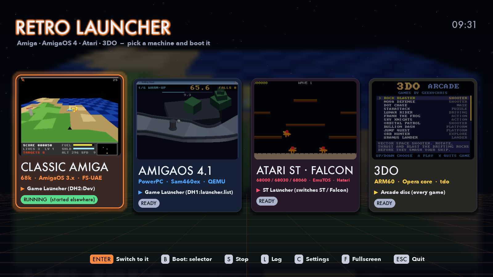

The menu has one card per machine. The selected card is raised and outlined
in its accent colour. Behind the cards, a blurred copy of its current
screenshot fills the background. The screenshots cross-fade every few
seconds.

Each card shows:

1. **Screenshots** from that machine's games.
2. **The title**, and a subtitle with the CPU, operating system and emulator.
3. **The boot line** (▶): what the machine will boot into next time, either
   its game selector or a plain desktop. Click it to switch modes.
4. **The status pill** (see below).

The clock is at the top right. The footer lists the keys, and every footer
button can be clicked.

| | |
|---|---|
| 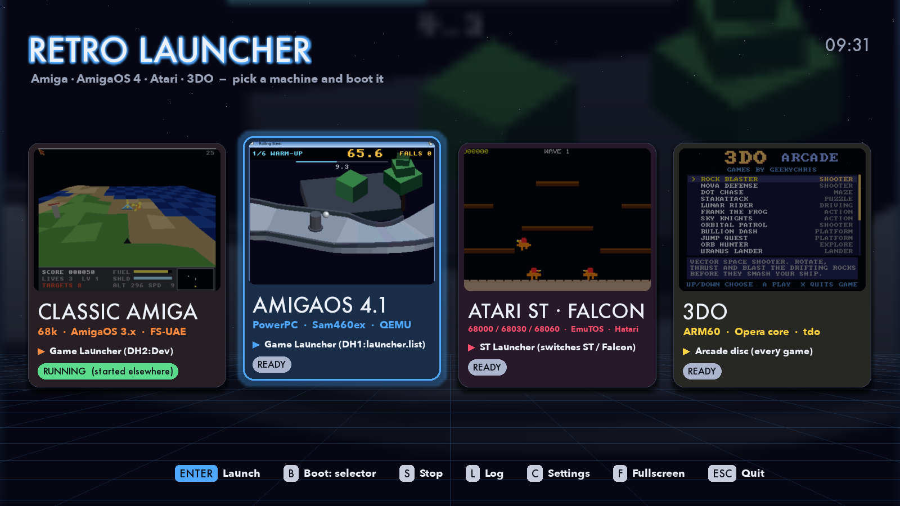 | 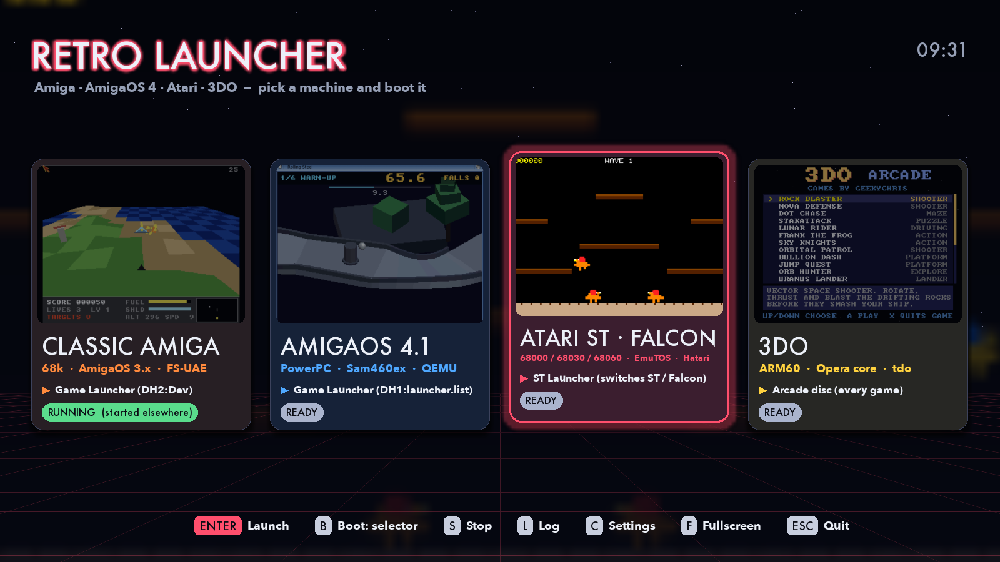 |
| 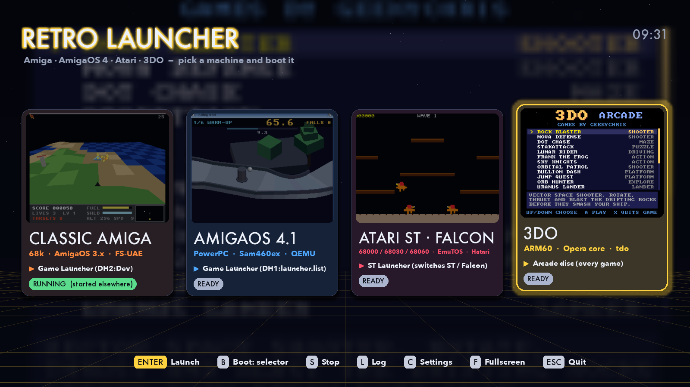 | 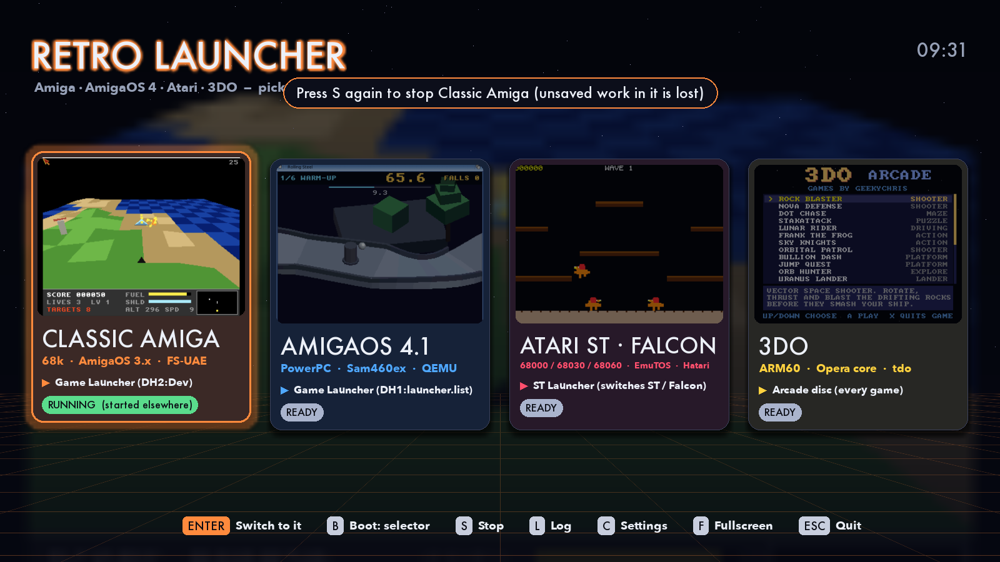 |

## Statuses

| Pill | Meaning |
|---|---|
| **READY** | Nothing is running and every path the machine needs exists |
| **RUNNING 3:12** | This launcher started the emulator; the time is how long it has run |
| **RUNNING (started elsewhere)** | A matching emulator process is running that this launcher didn't start: from a terminal, a script or an earlier launcher |
| **STARTING** / **PREPARING: …** | The steps before the boot are running (e.g. writing the boot flag); the pill names the program running |
| **FAILED: …** | The last launch failed or the emulator exited with an error. Press L for the log |
| **MISSING: name, …** | These paths from the machine's settings don't exist. Press C to fix them |

The running status comes from a process watcher that checks every two
seconds. See [How it works](how-it-works.md#detecting-running-emulators).

## Launching a machine

Select a card and press **Enter**, click the selected card, or press **A** on
a gamepad. Double-clicking any card launches it too.

The launcher then:

1. runs the machine's **prepare steps** for the chosen boot mode, in order
   (for the Amigas, this sets or clears the flag that decides whether the
   game selector starts);
2. starts the emulator, with its output going to the machine's log;
3. once the emulator has been up for a moment, brings its window to the
   front and leaves the menu behind it.

A toast at the top says what is starting. If a prepare step fails, the
emulator isn't started and the card shows FAILED.

`./run.sh --launch KEY` does the same as soon as the menu opens. So does
**General → Autostart machine** in the settings.

## Boot modes: game selector or plain

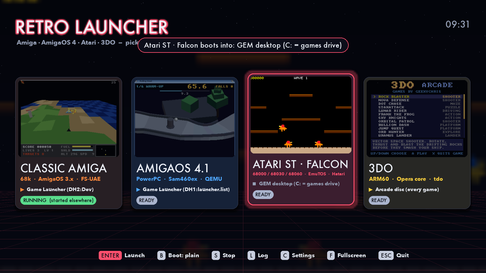

By default every machine boots straight into its own game selector, the menu
that runs inside the emulator. **B** (or clicking the boot line, or **X** on
a gamepad) switches the selected machine to a plain boot: Workbench, the GEM
desktop or a single 3DO game. Press B again to switch back. The choice is
saved.

**Shift+Enter** launches in the other mode once, without changing the saved
choice.

The setting behind this has three values per machine: `default` (follow
**General → Boot into game selectors**), `on` and `off`. B sets whichever
value gives the mode you asked for.

How each machine is told which way to boot is described in
[The machines](machines.md).

## Switching to a running machine

When a card says RUNNING, **Enter**, a click or **A** brings that emulator's
window to the front. The footer's first button then reads **Switch to it**.
This works for emulators the launcher didn't start too.

The launcher finds the emulator's processes: the ones the watcher matched,
plus everything started under the launch it made, since a start script's
emulator runs as a child. It then asks the operating system to activate the
first one that has a window. See
[How it works](how-it-works.md#bringing-a-window-to-the-front).

## While you play

**General → While playing** decides what the menu does once an emulator
is in front:

* **background** (default): the menu stays open, full screen, behind the
  emulator's window. It redraws gently (10 frames a second) while it doesn't
  have focus. Click it at any time to come back.
* **hide**: the menu disappears completely.

Either way, when the emulator quits, the menu comes back to the front by
itself.

## Stopping an emulator

Press **S** on a running card. The first press asks for confirmation in a
toast, since unsaved work in the emulator is lost. A second **S** stops it.
Emulators the launcher started are stopped with their whole process group
(SIGTERM, then SIGKILL after four seconds). Emulators started elsewhere are
sent SIGTERM (`taskkill` on Windows).

**General → Stop others on launch** stops every emulator this launcher
started before it starts another one.

Quitting the launcher (Esc or Q) leaves the emulators running.

## Logs

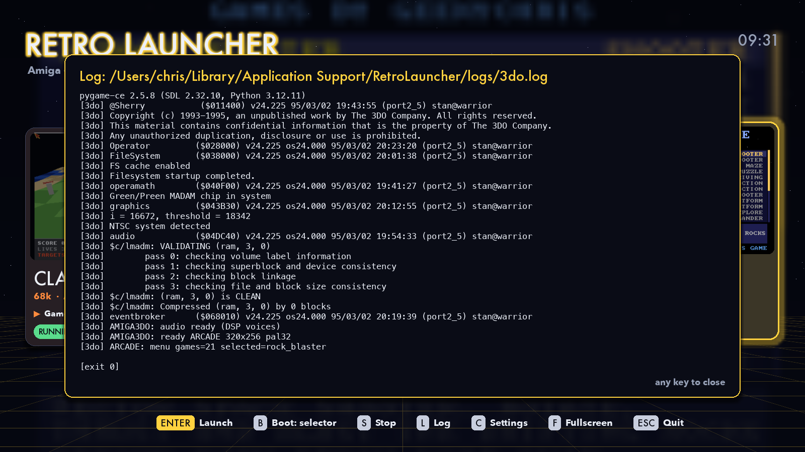

Every launch writes its prepare steps, the command lines and the emulator's
output to a log per machine:

* macOS: `~/Library/Application Support/RetroLauncher/logs/<machine>.log`
* Linux: `~/.config/retro-launcher/logs/<machine>.log`
* Windows: `%APPDATA%\RetroLauncher\logs\<machine>.log`

**L** shows the last 40 lines. Any key closes it.

## The settings screen

Press **C** (or **Start** on a gamepad). Up/Down chooses a row, Left/Right or
Tab changes tab, Enter changes the row, and Esc goes back. The path the
settings are saved to is shown at the top. Every change is saved straight
away.

### General

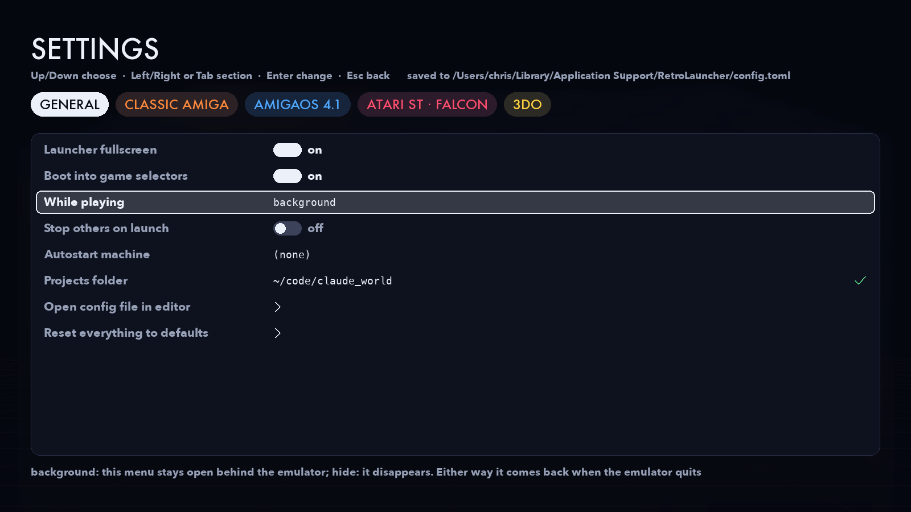

| Setting | |
|---|---|
| Launcher fullscreen | The menu fills the screen (F toggles it too) |
| Boot into game selectors | The default boot mode for every machine |
| While playing | `background` or `hide` (see above) |
| Stop others on launch | Starting a machine stops the others this launcher started |
| Autostart machine | Launch this machine as soon as the menu opens |
| Projects folder | `{projects}`: the folder holding the sister projects. Marked ✗ if it doesn't exist |
| Open config file in editor | Opens `config.toml` in the system's editor |
| Reset everything to defaults | Press Enter twice |

### A machine's tab

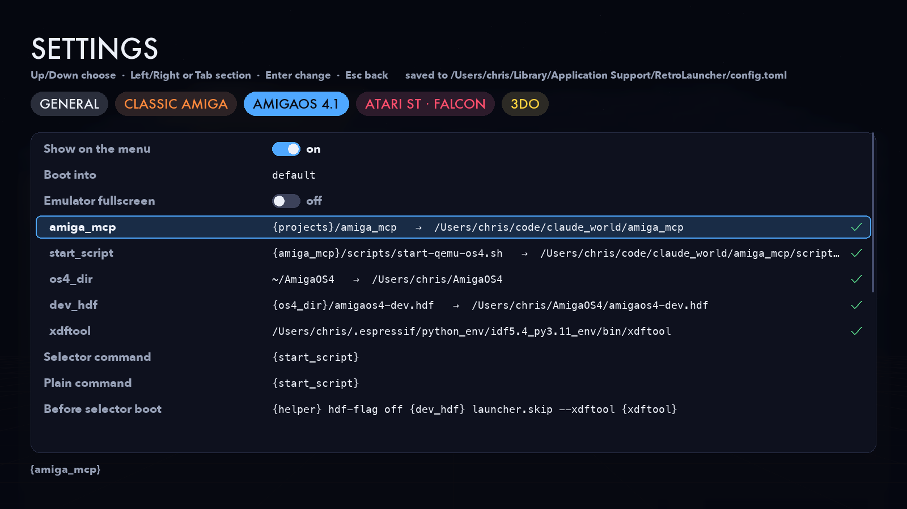

| Setting | |
|---|---|
| Show on the menu | Leave a machine off the menu without deleting its settings |
| Boot into | `default`, `on` (game selector) or `off` (plain) |
| Emulator fullscreen | Turns on the `?fullscreen:` words in the commands and the `env_fullscreen` variables |
| *paths* (indented) | The machine's `[paths]`. Each row shows the template, what it expands to, and ✓ / ✗ |
| Selector command, Plain command | The emulator command for each boot mode |
| Before selector boot, Before plain boot | Prepare steps, separated by `;;` |
| Working folder | Where the commands run |
| Running-process match | Text in a process's command line that means this emulator is running |
| Title, Subtitle, Accent colour, Selector label, Plain label | How the card looks |
| Preview commands | Shows exactly what both boot modes would run |
| Show last log | The machine's last launch log |
| Reset this machine to defaults | Press Enter twice |

| | |
|---|---|
| 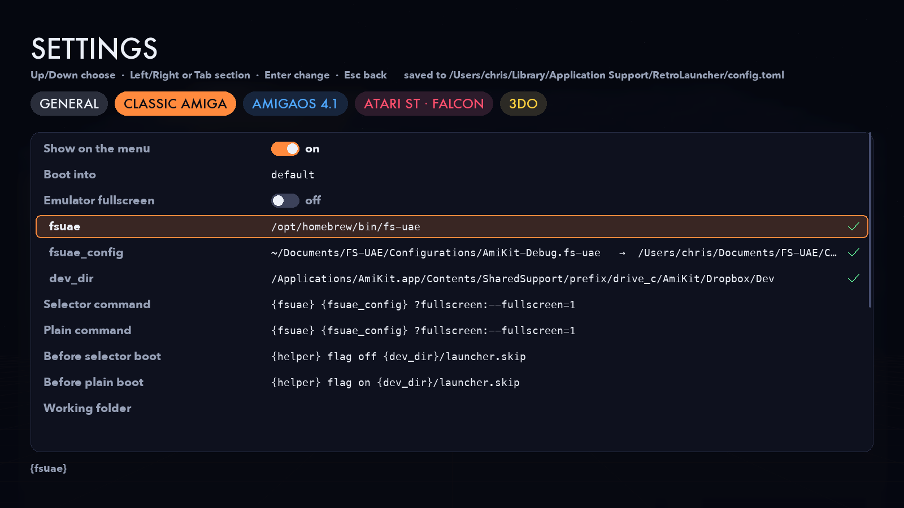 | 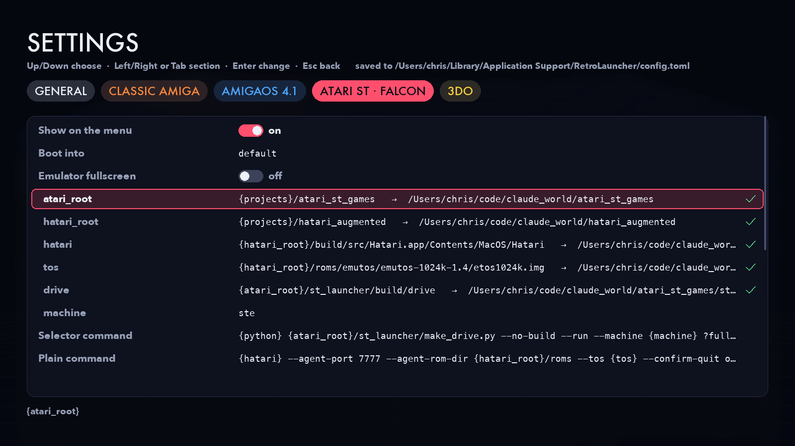 |
| 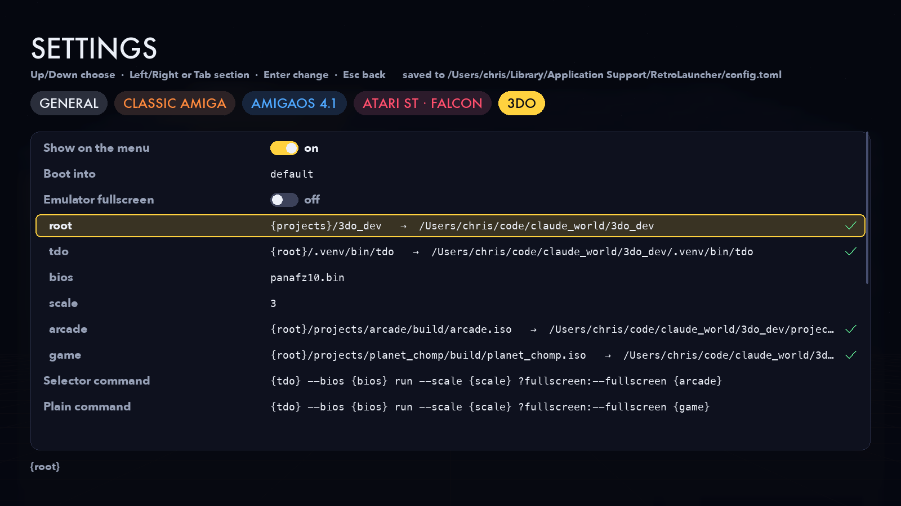 | 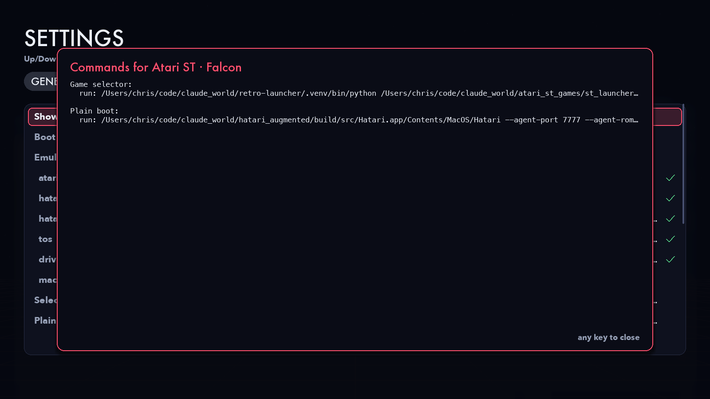 |

### Editing text

Enter on a text row opens an editor in place:

| Key | |
|---|---|
| ← → | move the cursor |
| Home / Ctrl+A (⌘A) | start of the line |
| End / Ctrl+E (⌘E) | end of the line |
| Backspace / Delete | delete |
| Ctrl+U (⌘U) | clear the line |
| Ctrl+V (⌘V) | paste |
| Enter | save |
| Esc | cancel |

After you save a path, its ✓ / ✗ shows whether the new value exists.

## Controls reference

| Key | Mouse | Gamepad | Does |
|---|---|---|---|
| ← → (A/D, Tab), 1–6 | wheel, click a card | d-pad / left stick | choose a machine |
| Enter / Space | click the selected card, double-click any card | A | launch, or switch to a running machine |
| Shift+Enter (or Alt+Enter) | | | launch in the other boot mode, once |
| B | click the boot line | X | toggle game selector ↔ plain boot |
| S, S | | B | stop the emulator |
| L | | Y | the last launch's log |
| C | | Start / Back | settings |
| F | | | launcher fullscreen on/off |
| Esc / Q | | | quit (emulators keep running) |

In the settings, the gamepad's stick and d-pad move between rows and tabs,
A changes a row and B goes back.
